## AI for CAD/CAM {#ai-cad}

- [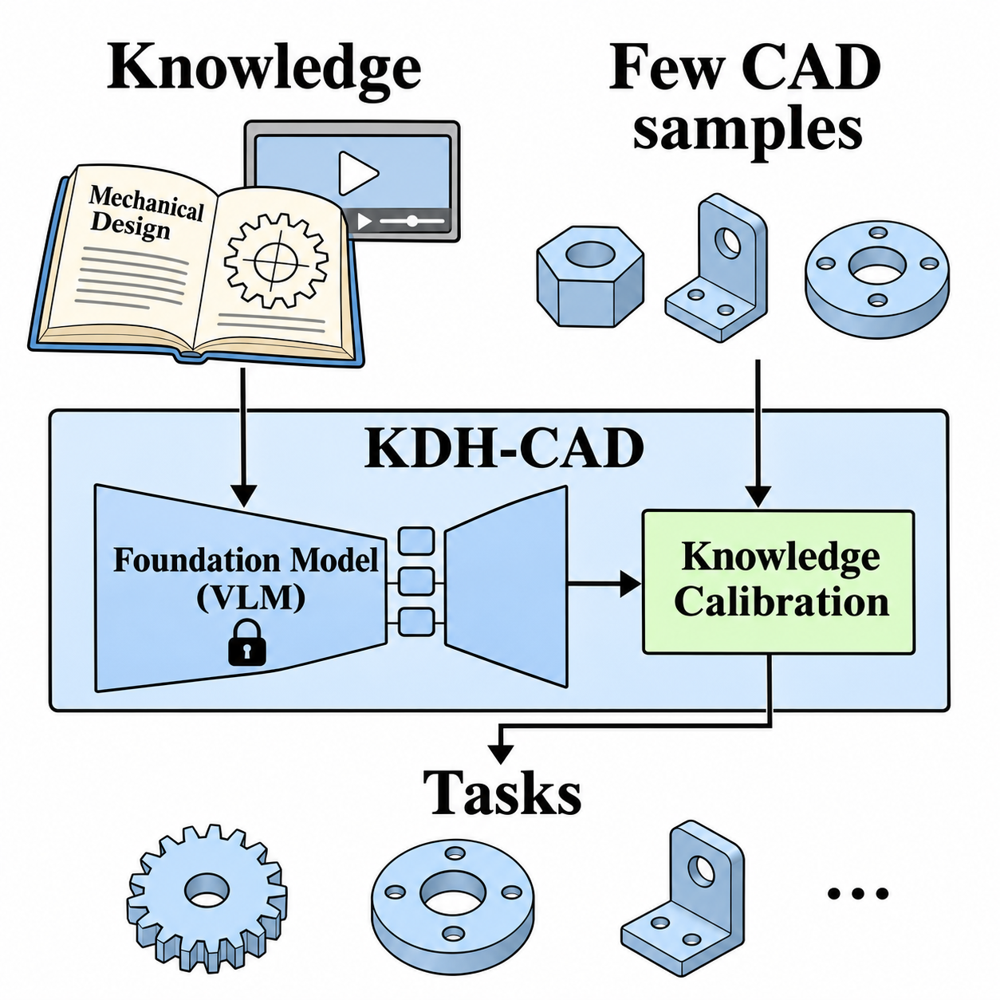](/images/codes/kdh-cad.png){: #kdh-cad}

  **KDH-CAD: Knowledge–data hybrid CAD learning under data scarcity**

  Knowledge elicitation and calibration with a frozen foundation model and a small CAD dataset.

  [Code](https://github.com/Qiang-Zou/KDH-CAD) · [Paper](https://doi.org/10.1016/j.cad.2026.104158)

- [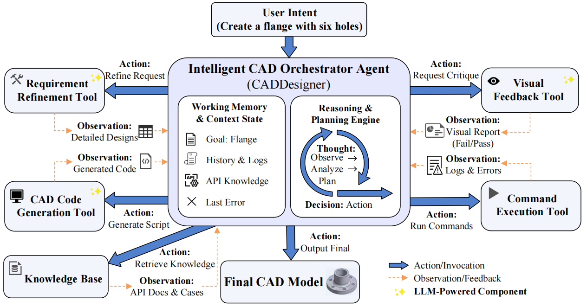](/images/codes/caddesigner.png){: #caddesigner}

  **CADDesigner: Conceptual CAD model generation with a general-purpose agent**

  An LLM-powered agent for conceptual CAD design from text and sketches, with requirement refinement and visual feedback.

  [Code](https://github.com/562590763/CADDesigner-Code) · [Paper](https://doi.org/10.1016/j.cad.2026.104087)

  <!-- Image source: https://github.com/562590763/CADDesigner-Code/blob/main/assets/framework.png -->

- [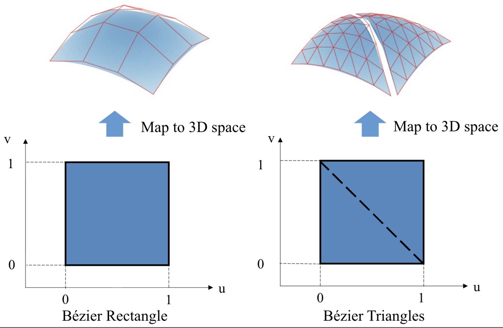](/images/codes/brt.jpg){: #brt}

  **BRT**

  Boundary Representation Learning via Transformer

  [Code](https://github.com/Qiang-Zou/BRT) · [Paper](https://doi.org/10.1016/j.cad.2025.103940)

- [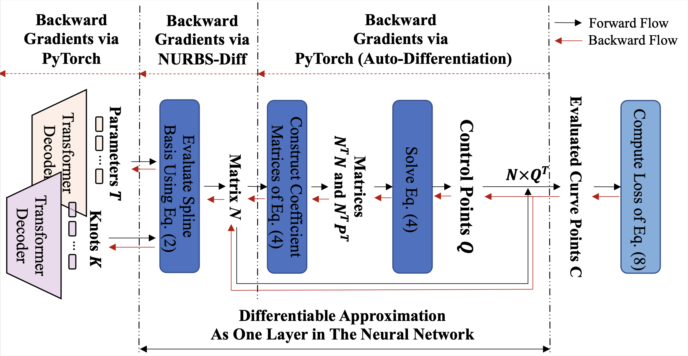](/images/codes/splinegen.png){: #splinegen}

  **SplineGen**

  data-driven, generative AI-based B-spline modeling

  [Code](https://github.com/Qiang-Zou/SplineGen) · [Paper](https://doi.org/10.1016/j.cad.2024.103809)

## Surface and Solid Modeling {#surfaces-solids}

- [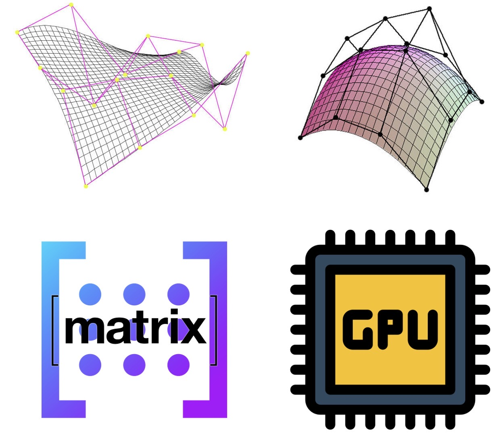](/images/codes/matrix-cad.jpg){: #matrix-cad}

  **Matrix-CAD**

  Matrix representation and GPU-optimized B-spline computing

  [Code](https://github.com/Qiang-Zou/Matrix-CAD) · [Paper](https://doi.org/10.1016/j.cad.2025.103948)

- [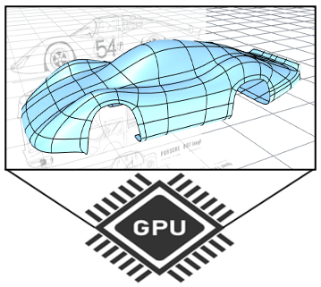](/images/codes/GPU-NURBS.png){: #gpu-nurbs}

  **GPU-NURBS**

  GPU parallel evaluation and inverse evaluation of NURBS curves/surfaces

  [Code](https://github.com/Qiang-Zou/GPU-NURBS) · [Paper](https://www.jcad.cn/cn/article/doi/10.3724/SP.J.1089.2023.2023-00003)

## Microstructure Modeling {#microstructures}

- [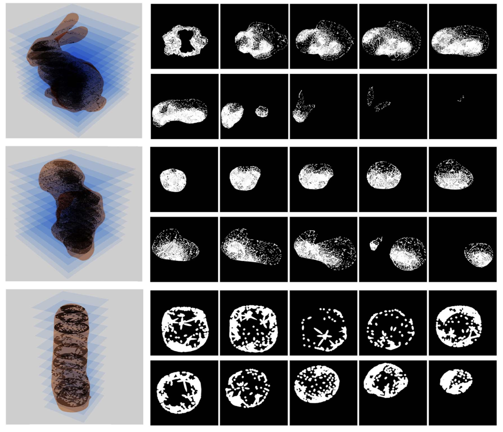](/images/codes/ImplicitSlicer.png){: #implicitslicer}

  **ImplicitSlicer**

  Implicit and Direct Slicer for Highly Complex Structures

  [Code](https://github.com/Qiang-Zou/ImplicitSlicer) · [Paper](https://asmedigitalcollection.asme.org/computingengineering/article/21/6/061003/1100541/Memory-Efficient-Modeling-and-Slicing-of-Large)

- [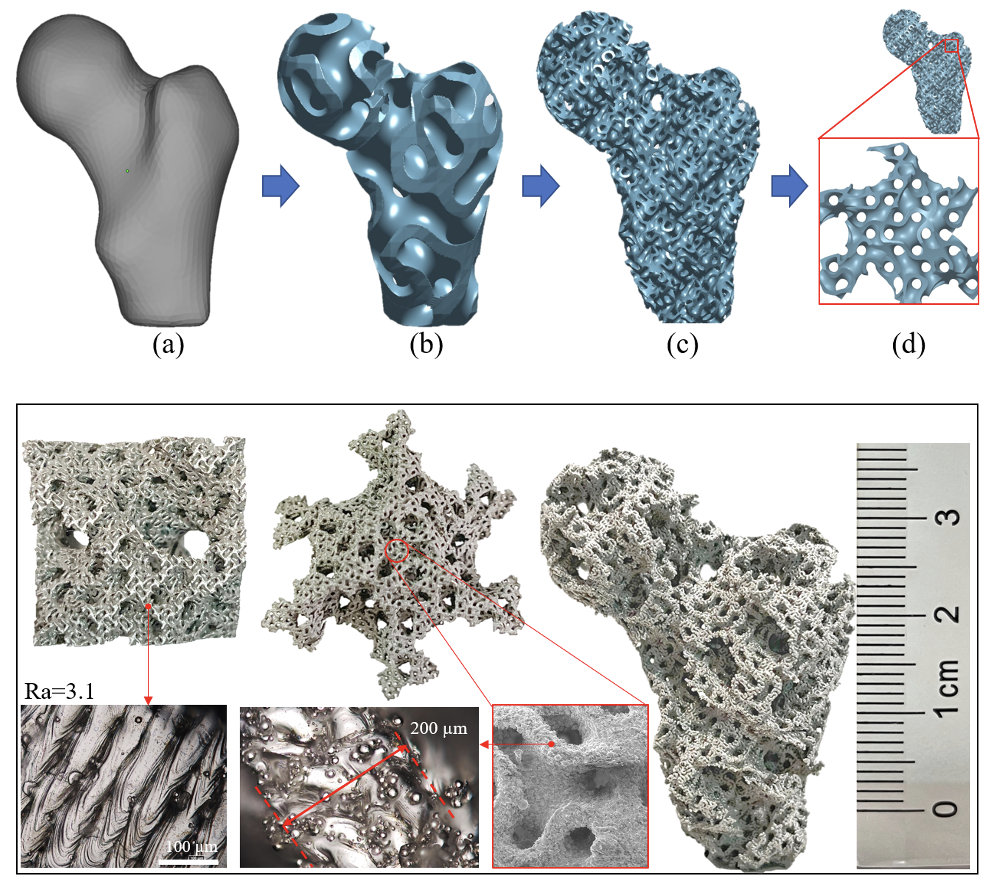](/images/codes/TPMSSlicer.png){: #tpmsslicer}

  **TPMSSlicer**

  A lightweight slicer for TPMS models

  [Code](https://github.com/Qiang-Zou/TPMSSlicer) · [Paper](https://www.sciencedirect.com/science/article/abs/pii/S0007850621000123)

- [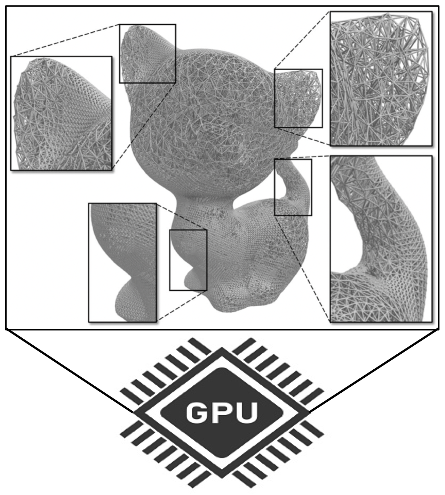](/images/codes/GPULatticeSlicer.png){: #gpulatticeslicer}

  **GPULatticeSlicer**

  A GPU-based parallel implicit slicing method for modeling and fabricating highly complex lattice structures

  [Code](https://github.com/Qiang-Zou/GPULatticeSlicer) · [Paper](https://www.sciencedirect.com/science/article/abs/pii/S0007850621000123)

- [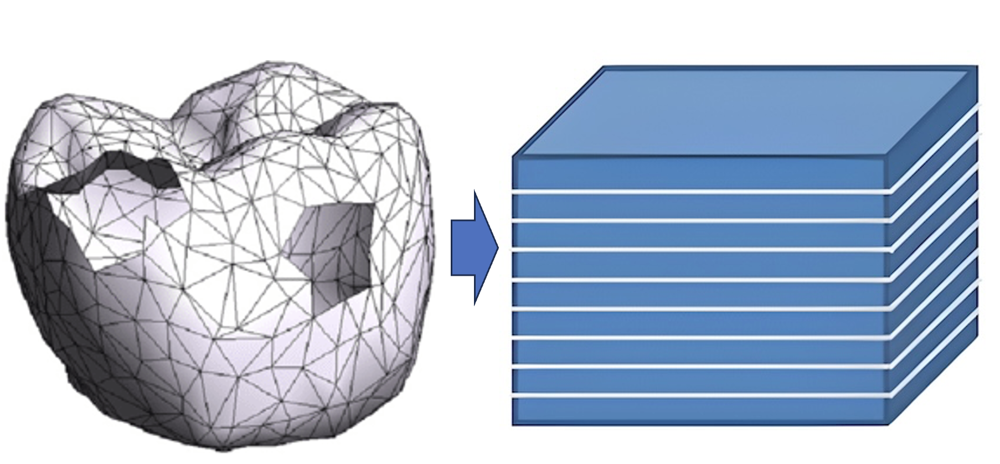](/images/codes/DirtyMeshSlicer.png){: #dirtymeshslicer}

  **DirtyMeshSlicer**

  A robust slicer for meshes with defects such as holes, cracks, and flipped normals

  [Code](https://github.com/Qiang-Zou/DirtyMeshSlicer)

- [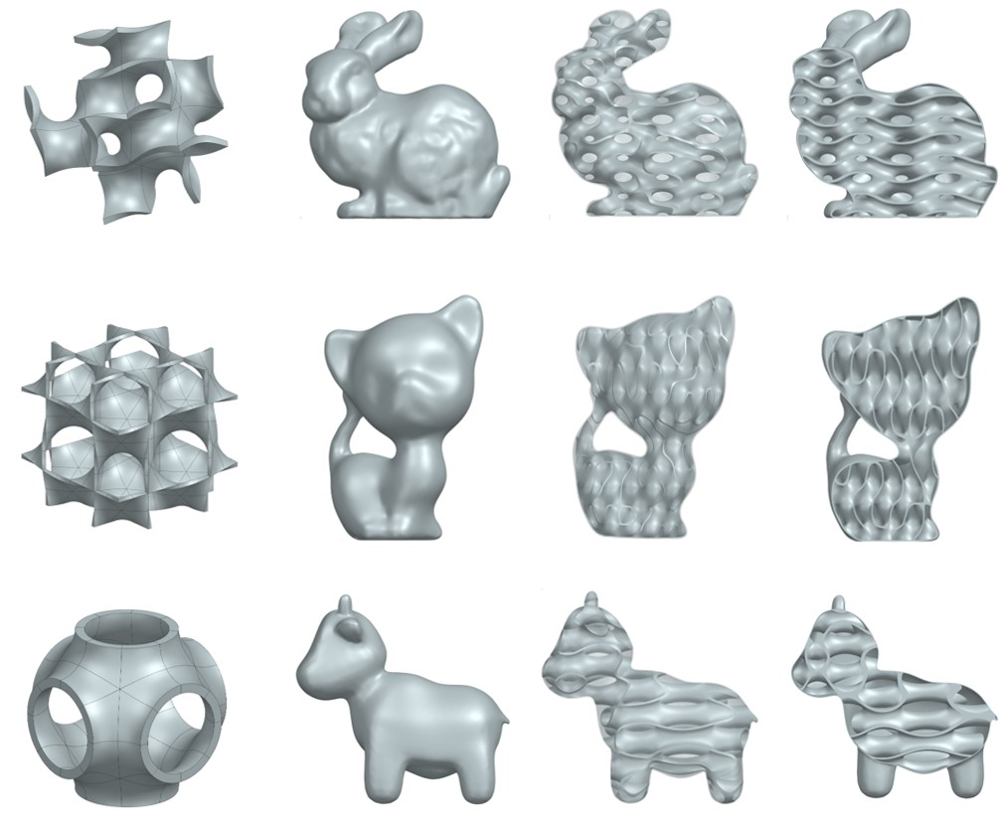](/images/codes/TPMS2STEP.jpg){: #tpms2step}

  **TPMS2STEP**

  A lightweight tool for converting TPMS models to STEP files to be used in conventional CAD/CAM/CAE pipeline

  [Code](https://github.com/Qiang-Zou/TPMS2STEP) · [Paper](https://doi.org/10.1016/j.cad.2024.103726)

- [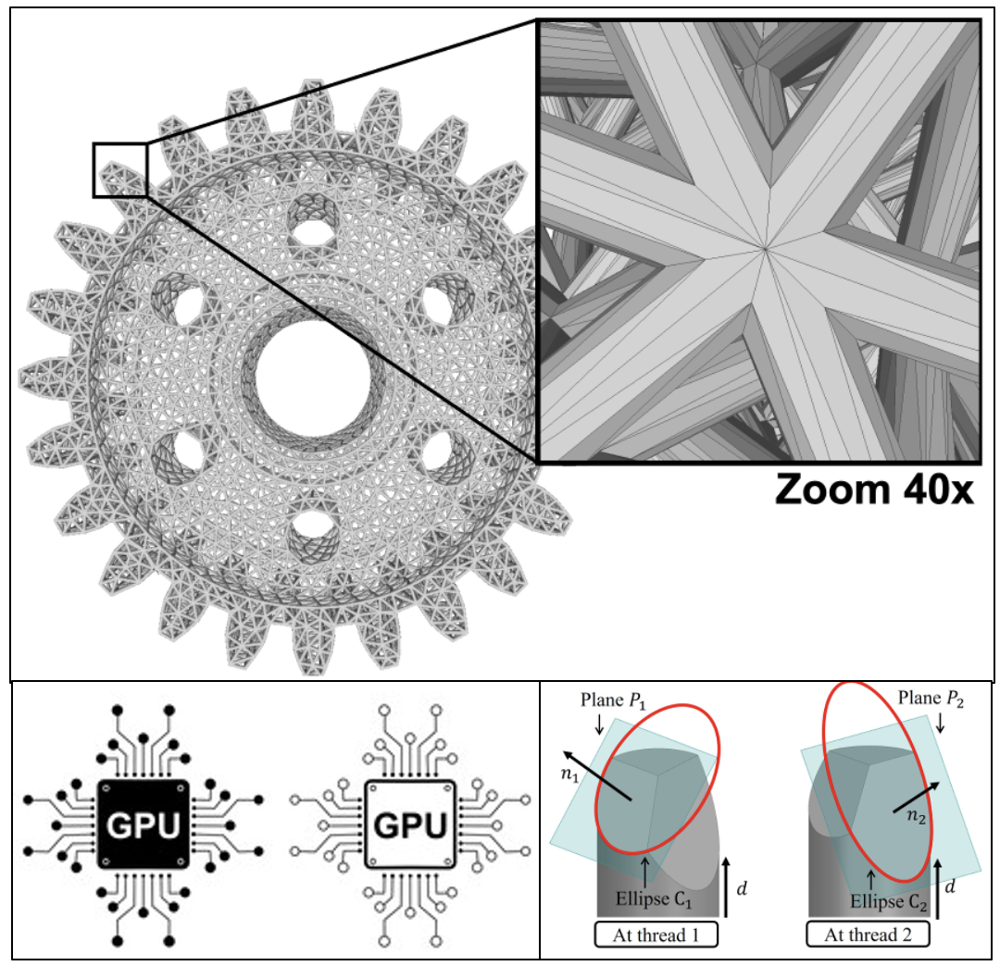](/images/codes/MetaMesh.png){: #latticemetamesher}

  **LatticeMetaMesher**

  A lightweight tool for metameshing and triangulating large-scale lattice structures (million or billion scales)

  [Code](https://github.com/Qiang-Zou/MetaMesh) · [Paper](https://doi.org/10.1016/j.cad.2024.103732)

- [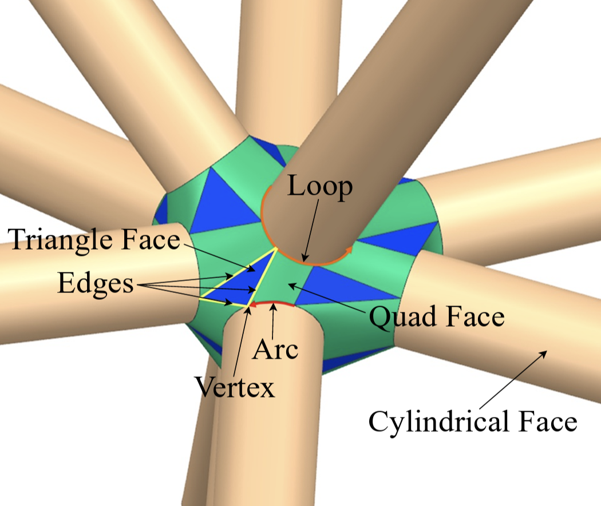](/images/codes/latticeconstruction.png){: #latticeconstruction}

  **LatticeConstruction**

  A Quasi-Optimal Shape Design Method for Lattice Structure Construction

  [Code](https://github.com/Qiang-Zou/LatticeConstruction) · [Paper](https://doi.org/10.1115/1.4068955)

- [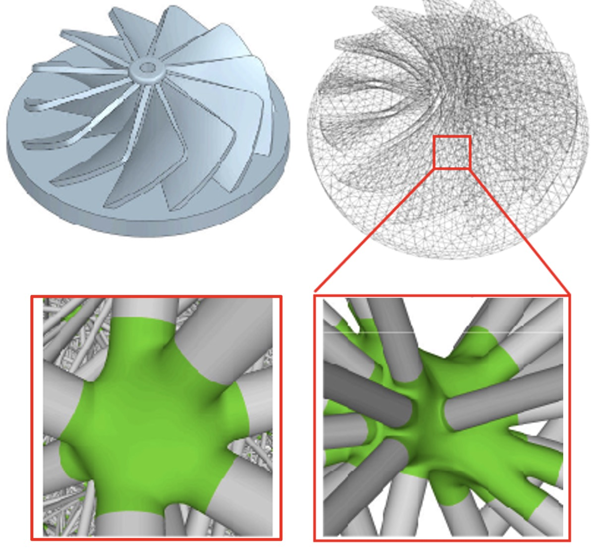](/images/codes/SubdivLattice.jpg){: #subdivlattice}

  **SubdivLattice**

  Soap Film-inspired Subdivisional Lattice Structure Construction

  [Code](https://github.com/Qiang-Zou/Subdiv-Lattice) · [Paper](https://doi.org/10.1016/j.cad.2025.103950)
